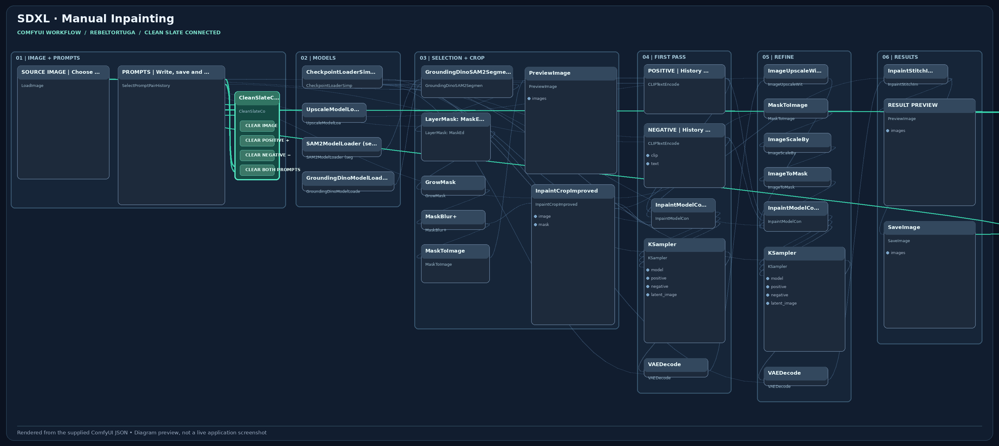

# Free Local SDXL Inpainting

**Workflow by:** RebelTortuga  
**Platform:** Local ComfyUI; prepared for a Windows setup, including Stability Matrix  
**Cost:** Free to use. No payment, paid API, subscription, or generation credits are required by this workflow.

**A note from RebelTortuga:** I put this workflow together to make local image editing easier to follow, with the image, prompts, mask previews, and editing stages organized in one place. You describe the object to select, review the mask, and control the edit settings before generating. I’m sharing it free with the community. Suggestions, new feature ideas, and constructive feedback are welcome.

SDXL image editing with text-guided object selection, mask refinement, crop-and-stitch inpainting, and an upscale/refinement pass.

This is an independent community workflow, not an official product of the ComfyUI or model developers. Model weights and custom nodes are installed separately. You need suitable hardware, storage, and electricity; paid cloud hosting is not required. Results and performance depend on your setup.

## Free Local AI — No Paid Service Required

**Price: $0 for this workflow.** It runs image/video inference on your own computer with locally installed models. The provided graph has **no paid API calls, subscription requirement, credit balance, or required account with a hosted generator**.

- Download and import the included `workflow.json` at no charge.
- Install ComfyUI, the listed free custom nodes, and compatible local model files separately.
- You need a capable GPU, disk space, and electricity; model and component licenses still apply.
- Optional third-party hosting or services are **not part of this workflow** and may charge fees.

## Workflow preview (illustration)

*Layout diagram rendered from this repository's `workflow.json`; not a live ComfyUI screenshot.*

## Clean Slate Controller

The workflow includes the [RebelTortuga Clean Slate Controller](https://github.com/RebelTortuga/comfyui-clean-slate). Its `image_1`, `positive`, and `negative` inputs are connected to the source image and the corresponding Prompt History outputs. Five buttons clear the image, either prompt, both prompts, or all three. Prompt History remains enabled and stores history locally on each user's own machine; no previous prompt entries or images are bundled.
## Start here

1. Install/update [ComfyUI](https://github.com/Comfy-Org/ComfyUI) locally, either directly or through [Stability Matrix](https://github.com/LykosAI/StabilityMatrix).
2. Install the custom nodes listed in [Dependencies](DEPENDENCIES.md). Use the Python environment belonging to that ComfyUI installation for each extension's requirements.
3. Download the models listed below. Keep their upstream names or reselect renamed files in the loaders.
4. Restart ComfyUI, refresh the browser, and drag `workflow.json` onto the canvas. This is a UI workflow, not an API-format prompt.
5. Follow the workflow steps below. No API key or paid service is required by this graph.

## Requirements

- A working local ComfyUI installation with support for the exact node types in `DEPENDENCIES.md`.
- The listed custom nodes and model files; they are not included in this ZIP.
- Sufficient GPU/system memory and disk space for the selected models and settings. A hardware minimum has not been verified.
- Internet access for initial downloads. The supplied graph uses local inference rather than a paid API.
- Python is needed for ComfyUI; the optional validation script uses the Python standard library. Git is optional when downloading ZIP packages.

## Models

| Loader selection / filename | Location under ComfyUI | Source / instructions |
|---|---|---|
| `epicrealismXL_pureFix.safetensors` | `models/checkpoints` | Obtain the exact epicRealism XL Pure Fix release from its author; inspect its model license. No verified download URL is embedded. |
| `4xUltrasharp_4xUltrasharpV10.pt` | `models/upscale_models` | Obtain the matching 4x UltraSharp model from its author. Exact release URL is not established here. |
| `sam2_1_hiera_small.pt` | `See SAM2 extension instructions` | Use the SAM2 extension model setup. |
| `GroundingDINO_SwinT_OGC (694MB)` | `See SAM2 extension instructions` | This is a loader selection label, not a literal filename. |

## Using the workflow

1. Load your image and enter positive/negative prompts in the prompt-history node.
2. Replace `pink top` in GroundingDINO/SAM2 with the object you want selected.
3. Inspect the mask preview; tune detection and mask-edge controls before rendering.
4. Run the workflow. It performs crop-and-stitch inpainting, followed by 4× upscaling and another sampling pass.
5. Inspect the final result and save output in ComfyUI's output directory.

Despite the original “All Manual” filename, this uploaded graph takes its active mask from SAM2; the painted LoadImage mask is not the active selection source. To use a painted mask, reconnect the LoadImage MASK output into the mask-processing chain in a separate copy. This repository preserves the submitted graph.

The first sampler uses 30 steps, CFG 7, denoise 0.85; the second uses 20 steps, CFG 8, denoise 0.4. The upscaling pass can require substantially more memory.

## Prompt history and blank defaults

Positive and negative prompt fields and the input-image selection start blank. Prompt pairs are saved to a relative `user/prompt_history/` JSON path. History is not bundled. Ensure the directory is writable and use the history node's edit mode for a new prompt. Saved history may contain private text; do not commit it.

If `SelectPromptPairHistory` is unavailable, install/update the exact PromptHistory extension in Dependencies. A free fallback is to remove that node in a copy and enter positive/negative text directly into the two text-encoding nodes, disconnecting their prompt-string inputs first. This fallback changes the graph and is not the supplied default.

## Troubleshooting

- **Red/missing nodes:** compare exact node type names in `DEPENDENCIES.md`; different SAM2 or similarly named extension packages are not interchangeable.
- **Missing model:** verify its folder, refresh model lists and select the installed filename in the loader.
- **Out of memory:** reduce image dimensions/frame count as applicable; close other GPU applications. Quantization/tiled decoding do not guarantee a particular GPU will fit.
- **Blank/incorrect result:** check prompts, loaded image, masks, switch mode and selected models.
- **Dependency installation:** follow each upstream README; avoid installing packages into an unrelated global Python.

## Validation and provenance

The workflow is derived from the actual Clean Slate JSON uploaded by the author. Source image and active prompts are blank. Prompt History retains its local save/recall configuration. Two source graphs needed a corrected negative-prompt link; all generation settings are preserved. `SOURCE.json` records the uploaded filename, checksum and changes.

Run `python scripts/validate_workflow.py` to check graph references. Structural checks passed during packaging. No GPU inference, clean-machine installation, visual output quality, or complete dependency-version compatibility was tested here. Exported core node version metadata is not a certified minimum ComfyUI version.

## Frequently asked questions

**What should I do if the wrong object is masked?** Refine the text description or edit the mask manually, then inspect the mask preview before generating.

**Why do image edges look different after an edit?** Recheck crop, mask blur and stitching settings; inspect the mask transition before an upscale pass.

**Do I need paid AI services?** No. The workflow uses local ComfyUI inference, provided you install compatible models and extensions.

**What if nodes or models are missing?** Follow `DEPENDENCIES.md`, verify the documented model folders, restart ComfyUI and reselect filenames where needed.

## 🔗 Related Free RebelTortuga Projects

Explore other free tools and workflows:

- [comfyui-clean-slate](https://github.com/RebelTortuga/comfyui-clean-slate)
- [comfyui-free-local-qwen-image-edit](https://github.com/RebelTortuga/comfyui-free-local-qwen-image-edit)
- [comfyui-free-local-wan-video-quality](https://github.com/RebelTortuga/comfyui-free-local-wan-video-quality)
- [comfyui-free-local-wan-video-high-resolution](https://github.com/RebelTortuga/comfyui-free-local-wan-video-high-resolution)

[Browse all RebelTortuga projects](https://github.com/RebelTortuga)

## 🐢 Support RebelTortuga

These workflows are free to download and use. Donations are always optional and do not unlock features.

**[☕ Help this turtle get a new shell on Ko-fi!](https://ko-fi.com/rebeltortuga)**

Contributions help me explore AI, improve workflows, and share free tools. Bug reports and useful suggestions are equally welcome.

## Credits and licensing

The workflow JSON, preview and original documentation in this repository are released under the [MIT License](LICENSE) by RebelTortuga. Model weights, ComfyUI, custom nodes and third-party components are **not included** and retain their own separate licenses and attribution requirements. Review those terms before downloading, redistributing or using them commercially.

## Documentation and help

- **README.md** — start here, requirements, model files, use, and troubleshooting.
- **OPTIONS-README.md** — a plain-language guide to prompts, settings, and the workflow's main stages.
- **DEPENDENCIES.md** — custom-node sources and the exact node types used.
- **CHANGELOG.md** — changes to this repository package.
- **SOURCE.json** — source filename and checksum.

## Feedback and suggestions

Use this repository's GitHub Issues page for bug reports, improvements, and feature requests. Include the workflow name, ComfyUI version, GPU/VRAM, relevant error text, and what you expected to happen. Review logs and screenshots for personal information before sharing them.

## Clean template defaults

Images and active positive/negative prompts start blank. Prompt History auto-save and recall remain enabled; the history JSON files themselves are **not** bundled. The preview PNG is included at `assets/workflow-preview.png`.

---

<!-- BEGIN REBELTORTUGA SAFETY -->
## Privacy & Software Safety

Read the [project safety guidance](SAFETY.md) before use. It covers local workflows, dependencies, saved files, and security warnings. See [SECURITY.md](SECURITY.md) for vulnerability reporting and the [license](LICENSE) for terms.

[Privacy & Software Safety](https://rebeltortuga.github.io/privacy-software-safety.html) · [Project Licenses](https://rebeltortuga.github.io/project-licenses.html)

Do not upload passwords, access tokens, browser profiles, private backups, or unredacted diagnostic reports to public issues.
<!-- END REBELTORTUGA SAFETY -->

<!-- rebeltortuga-official-links:start -->
## Official RebelTortuga links

- 🌐 [Website](https://rebeltortuga.github.io/)
-  [GitHub](https://github.com/RebelTortuga)
-  [Twitch](https://www.twitch.tv/rebeltortuga)
-  [YouTube](https://www.youtube.com/channel/UCpMIirV8w5RfVd9TpKpA2pQ)
-  [Patreon](https://www.patreon.com/cw/RebelTortuga)
-  [Ko-fi](https://ko-fi.com/rebeltortuga)
<!-- rebeltortuga-official-links:end -->

## Official Project Guide

[View the comfyui-free-local-sdxl-inpainting project guide](https://rebeltortuga.github.io/projects/comfyui-free-local-sdxl-inpainting.html)
